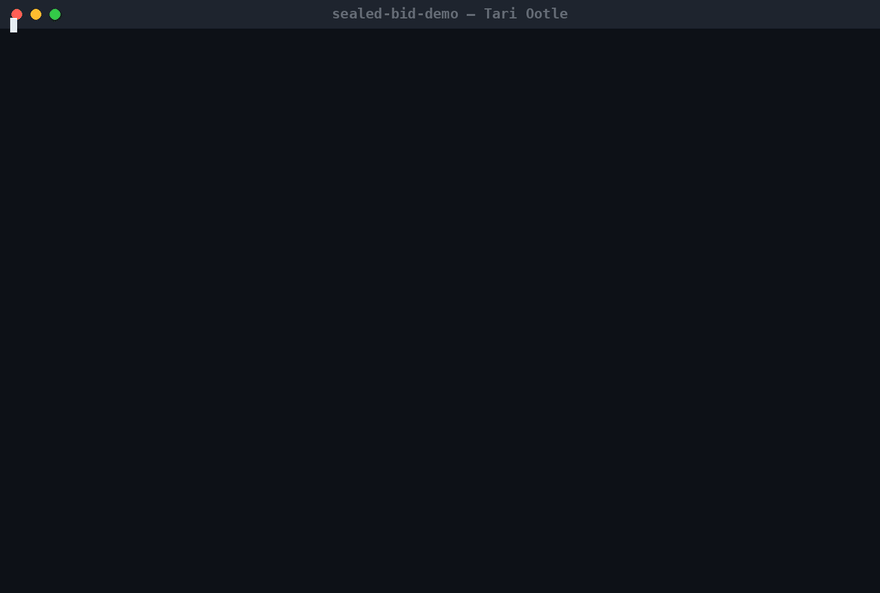

# Sealed Bids at Midnight

A sealed-bid auction template for [Tari Ootle](https://www.tari.com/) where **bid amounts do not exist on-chain until their owners reveal them**.

Built for the October 2026 "Spooky Secrets" community build contest — a demonstration of Tari's programmable privacy.



## The problem

On a transparent chain, submitting a bid puts it in a public mempool and state, where anyone can front-run it or bid one unit over it. Commit-reveal schemes fix the bidding phase, and they can be built on any chain; what makes this template native to Tari is how little machinery it needs — one WASM template, no external contracts, bonds and escrow as ordinary vaults, and identity straight from the transaction signer.

While the auction is sealed, privacy here is structural:

| | While bidding is open | After midnight (reveal window) |
|---|---|---|
| The chain sees | your public key, a Blake2b commitment, a bond identical for every bidder | the amounts, proven against the seals |
| Your bid amount | **never leaves your machine — it does not exist on-chain** | revealed by you, only after the sealing window has closed |

Honest limits (found the hard way, see the security review below): a bidder holding several sealed bids can choose which to open after seeing others' reveals, so the reveal window weakens true sealed-bid incentives unless the bond is large; and during the reveal window all opened amounts are public. The sealing phase itself remains opaque: commitments are domain-separated and bound to both the auction and the signer, and no amount exists on-chain until its owner reveals it.

## How it works

```
        epoch 0                    bidding_end                reveal_end
  ────────┬────────────────────────────┬──────────────────────────┬─────────
   seller creates auction         midnight: bids are        settlement: the lot
   bidders seal commitments       frozen; honest bidders    goes to the highest
   + equal anti-spam bonds        reveal + pay up front     bid, losers are
   (ghosts: bids that are never   ; ghosts stay silent      refunded, ghosts
   revealed forfeit their bonds)  and forfeit their bonds   forfeit to the seller
```

- **`place_bid(commitment, refund_account, bond)`** — the client computes `commitment = blake2b("sealed_bid/v1" ‖ component ‖ pk ‖ blinding32 ‖ amount_le)`. The bond is the same for every bidder, so it leaks nothing.
- **`reveal(blinding, amount, payment)`** — the template recomputes the hash from the unforgeable signer public key and pays the exact amount up front. The bond is returned immediately to honest bidders.
- **`settle()`** — highest revealed bid at or above the reserve wins (earliest reveal breaks exact ties). Settlement is **pull-based**: `settle()` only records the winner; the lot, the proceeds and every refund are then claimed individually (`claim_lot`, `claim_proceeds`, `claim_refund`), so no failed deposit can ever lock someone else's funds. **Ghost bids — sealed, never revealed — have their bonds locked in the component forever**: paid to no one, not even the seller, so shill bids that stay sealed are pure cost.

The official Ootle `nft_marketplace` starter ships an English auction and leaves blind auctions as a TODO: *"requires cryptography support"*. This template closes that gap with Ootle's native primitives: hashing intrinsics, `CallerContext` identity, consensus epochs for phases, and vaults for escrow.

## Repo layout

- `src/lib.rs` — the `SealedBidAuction` template (WASM, `tari_template_lib` 0.40)
- `tests/test.rs` — 17 integration tests via `tari_template_test_tooling`: full lifecycle, tie-breaking in both seal orders, reserve semantics, cross-auction commitment binding, capacity cap, constructor and window rejections, claim authorization and replay, and a 20-bidder scale run
- `demo/` — a headless CLI client (`ootle-rs`) that drives the whole auction lifecycle on a network
- `demo/bridge.sh` — L1 → L2 bridge helper: burns tTARI on the L1 console wallet and funds the demo actors from the claimed UTXO

## Live on Ootle mainnet (November 2026)

The same template source (`src/lib.rs`, unchanged since the October submission) is built on the mainnet launch stack (`tari_template_lib` 0.40). It was published on mainnet on 12 November 2026 and then run through a complete auction.

- Template: `67a658cc6c9e1c3564871e378f0a60d0b4f8682222460c34aa852caa961df309`
- Publish tx: `6d0b9a0d76fc65423729046f9eeb190a5bf2caa8bc4dccbc5f66d7972266ee25`, finalized 12 November 2026 08:01:23 UTC (epoch 38512): <https://explorer.tari.mw/tx/6d0b9a0d76fc65423729046f9eeb190a5bf2caa8bc4dccbc5f66d7972266ee25>
- Auction: `component_f6112421c2ca0bc3d54591596af7baa3d3e0859259012b18244ca0e3660dc5ca`
- Published WASM: 202,153 bytes, sha256 `30e204257582696eedb0941b1447bff8ccd7909e7c67bfa74e813f491fb0a6d7`. The template substate carries exactly these bytes. To rebuild them, use rustc 1.99.0, the repo's `Cargo.lock` and `tari build` (tari-ootle-cli 0.30.0), with the cargo home remapped:

  ```bash
  RUSTFLAGS="--remap-path-prefix=${CARGO_HOME:-$HOME/.cargo}=/build/.cargo" tari build
  ```

  Rust keeps dependency source paths in panic messages. The remap pins them to `/build/.cargo/...`, so the hash does not depend on where the builder's cargo home is. The only other paths in the binary are the toolchain's own `/rustc/<commit>/...` ones.
- The lifecycle ran on mainnet with the demo client:
  - **Epoch 38512:** the auction opened right after the publish.
  - **Epoch 38513:** three commitments were sealed: 10 XTM, 20 XTM, and a 99 XTM ghost.
  - **Epoch 38515:** the two honest bids were revealed against their seals. The ghost stayed silent.
  - **Epoch 38520:** `settle()` (tx `19a30bbd88cfab628b46d3a6e2ebeb4419eb7d2408aa200d7c3b7bfe7c4d237b`) emitted `AuctionSettled`. Bidder2 won at 20 XTM, and one ghost bond was locked.
  - **After settlement:** bidder2 claimed the lot, the seller pulled the 20 XTM proceeds and bidder1 pulled a full refund. The loser's `claim_lot` and the winner's `claim_refund` were rejected by the template's own checks. The ghost's 2 XTM bond stays in its vault.
- Funding: mainnet has no faucet. 500 XTM were burned on Minotari L1 to the seller's claim key and claimed on L2. `demo/l1convert` converts the console wallet's burn proof, and `bootstrap` claims it and funds the demo actors. This is the same bridge path as on Esmeralda.

To drive an auction on mainnet with the demo client, the steps are:

```bash
cd demo
export DEMO_NETWORK=mainnet
DEMO=../target/debug/sealed-bid-demo
for a in seller bidder1 bidder2 ghost; do $DEMO new-actor $a; done   # each prints its L1 claim key
#   ... burn XTM on L1 to the seller's claim key, then convert the wallet's proof file:
(cd l1convert && cargo run --release -- <burn-proof.json> ../claim.json)
DEMO_FUND_SELF=1 DEMO_FUND_TARI=100 $DEMO bootstrap seller claim.json
$DEMO setup                        # publish the template, mint a lot, open the auction
$DEMO bots-bid                     # then bots-reveal after 3 epochs, settle after 5 more
```

The flags work as follows:
- `DEMO_FUND_TARI` sets how much XTM each actor receives.
- `DEMO_FUND_SELF=1` also gives the bridging actor its own account. The seller needs one, because it pays for the publish.
- `bootstrap` checks that the claim can cover every actor before it submits anything, because a burn can be claimed only once.
- The claim is accepted from the first L2 epoch after the one that contains the burn's L1 block.

## Live on the public Esmeralda testnet (republished November 2026 after the testnet reset)

The esmeralda testnet was reset on 2 November 2026 (tari-ootle v0.48/v0.49: state wipe, sr25519 signatures, component upgrade rules), and on 7 November the fleet moved to v0.50, which only loads templates whose definition uses the V2 layout of `tari_template_lib` 0.38. Per the contest's republish call the **same template source** — `src/lib.rs` byte-identical to the October submission — was rebuilt and republished. The only build changes: `tari_template_lib` 0.34 → 0.38, and the `build.rs` metadata step (`tari_ootle_template_build`, which wrote the old V1 layout) is gone because the library now emits the V2 `tari_tdef` section itself.

- Template: `f9279d11023d064296aa31fd0672104b439adc11838354ddb00aa452350e339a`
- Auction: `component_b2b00549b65c4acd7963f53b5c41f51dc4f76376e24b623d3d8dbbefc4c492e9`
- Published WASM: `tari build` with rustc 1.99.0 and the repo's `Cargo.lock` → `sealed_bid.wasm`, 201,654 bytes, sha256 `33e3ea84ab6a26e3db9e6de23c5f90a5953562621788028e0c64478b000f4c79` — the template substate on the indexer carries exactly these bytes. Before publishing, these exact bytes passed the v0.50.1 engine's registration checks (`WasmModule::validate_code`) and all 17 template tests; the tests also pass when compiled from source on `tari_template_test_tooling` 0.50.1.
- The full lifecycle then ran on these artifacts: at epoch 12928 the auction opened and three commitments were sealed (10, 20 and a 99 TARI ghost); at epoch 12931 the two honest bids were revealed against their seals and the ghost stayed silent; at epoch 12936 `settle()` (tx `8d27e7562f9f7f673ba5ea72404480418942ea398209bc8da6ca6d9947757ed0`) emitted `AuctionSettled` with bidder2 winning at 20 TARI and one ghost bond locked. Bidder2 then claimed the lot, the seller pulled the proceeds and bidder1 pulled a full refund; the loser's `claim_lot` and the winner's `claim_refund` were rejected by the template's own checks, and the ghost's 2 TARI bond is still in its vault. Final state on the public indexer:
  `https://ootle-indexer-a.tari.com/substates/component_b2b00549b65c4acd7963f53b5c41f51dc4f76376e24b623d3d8dbbefc4c492e9?local_search_only=false`
- The public XTR faucet starts **empty by design** on esmeralda (community-funded; on the restarted network the faucet component is not even instantiated yet), so the actors were funded the documented way: Minotari tTARI mined solo on L1, burned to the claim key and claimed on L2 — the same bridge `demo/bridge.sh` automates (now via the `demo/l1convert` helper, since the L1 crates and the current client stack no longer resolve in one dependency graph).
- Historical: the first republish on v0.49 (template `0e7fa82260bd395187fa0711ce68eccb86c25306a24ca208ac69b148d9aa4060`, auction `component_b5918c841b9d70694ac7cb9ef05fee965105bd7934d8e8221a3f3aefb1e93098`) stopped loading at the v0.50 upgrade; the October v2 artifacts (template `5e8f7b22fab899c5dc37c00caf9aeb53c3099a1ec2baff0b218354e37a6444db`, auction `component_7eb4f5f468cd23f01be92423459102b3e3d0760bdf1a578b93e64a00e159a184`) are gone with the wiped state.

## Quick start on a local network

Prerequisites: Rust with the `wasm32-unknown-unknown` target, and a local Ootle swarm running (`tari_swarm_daemon start --no-compile --binaries-root <binaries>`; its web UI is on `127.0.0.1:8080`, the indexer REST on `127.0.0.1:12007`).

```bash
cargo test                          # 17/17 template tests, no network needed
tari build                          # produce the WASM

cd demo
export DEMO_NETWORK=localnet DEMO_INDEXER_URL=http://127.0.0.1:12007
DEMO=../target/debug/sealed-bid-demo

$DEMO new-actor faucet-hero         # prints the L1 claim public key
./bridge.sh 15000 <claim-pubkey>    # burn on L1, claim on L2, fund all actors
$DEMO setup                         # publish the template, mint a lot, open the auction
$DEMO bots-bid                      # three sealed bids (10, 20 and a 99 TARI ghost)
#   ... advance a couple of epochs (swarm UI: Mine, or POST {"method":"mine"}) ...
$DEMO bots-reveal                   # the two honest bids open; the ghost stays silent
#   ... advance past the reveal window ...
$DEMO settle                        # settle and print every actor's balances
```

You can play manually at any point: `bid <actor> <tari>` (prints the blinding factor to keep), `reveal <actor> <tari> <blinding-hex>`, `info` dumps the on-chain auction state.

### A real run (localnet, October 2026)

```
=> bidder1 seals 10 TARI (commitment bac01bff79b4f04e...bbac213d) — the amount never leaves this machine
=> bidder2 seals 20 TARI (commitment 1c5ec22c93e23e0...99bc7b392)
=> ghost   seals 99 TARI (commitment 40ad3acbfe199421...893a5cc9)
All bids sealed. The chain sees commitments only — no amounts.
...
=> settling the auction
   event: SealedBidAuction.AuctionSettled { winner: bidder2, winning_bid: "20.000000", ghost_bonds_locked: "1" }

  [seller]   TARI + winning bid only (ghost bonds stay locked in the auction)
  [bidder1]  losing bid refunded in full
  [bidder2]  TARI + 1 × SPOOK "Haunted Portrait #13"   (the winner, claimed)
  [ghost]    bond locked forever: sealed and vanished
```

## Security review

Before submission the project went through AI-assisted adversarial security reviews (two rounds). All accepted findings were fixed in the v2 template and client (regression tests cover the behavioural items; rule-level fixes like OwnerRule::None are verified by code inspection):

- **Funds-locking settlement (critical):** `settle()` used to pay everyone in one transaction; one hostile account or bid spam could lock every bidder's funds. Settlement is now pull-based with per-party claims.
- **Seller traps:** overflowing epoch arithmetic could open settlement instantly — now checked; the component now has `OwnerRule::None`, so its rules can never be rewritten once escrow is held.
- **Shill-bond incentive:** forfeited bonds used to go to the seller, making sealed shill bids free. They are now locked in the component forever.
- **Commitment binding:** commitments are now domain-separated (`"sealed_bid/v1"`) and bound to the auction's component address with a mandatory 32-byte blinding, so they cannot leak across auctions or be brute-forced with short blindings.
- **Reserve fairness:** a valid reveal below the reserve used to reject outright; it is now accepted but forfeits the bond and simply cannot win.
- **Client:** bid blindings are persisted before the transaction is submitted, and bridge/refill statements carry explicit change outputs.

## Engineering notes

Platform constraints discovered while building this (each cost us a rejected transaction):

- Template method signatures only accept paths and tuples — `[u8; N]` arrays are rejected by the ABI, so the blinding factor travels as `Vec<u8>`.
- `tari_template_lib::intrinsics` (including hashing) only run inside the WASM engine; native tests recompute commitments with the `blake2` crate (same Blake2b-256 over the concatenated parts).
- Tari (the stealth TARI resource) cannot be burned by templates (`native.resource.Burn` is denied), so the original "ghost bonds burn at midnight" became bonds locked in the component forever — paid to no one, so a seller gains nothing from shill bids that stay sealed.
- A template that cross-calls another component (`account.deposit` during payouts) requires that component *and its vaults* to be declared as transaction inputs.
- Since tari-ootle v0.50 a published template may carry exactly one custom section, `tari_tdef` with the V2 definition: the `name`, `producers` and `target_features` sections the wasm toolchain emits are rejected at registration, so build with `tari build` (its release profile strips them) rather than a plain `cargo build`.
- An L1 burn claim pays its own fee out of the claimed UTXO, so the spendable amount is the proof value minus the receipt's `total_fees_paid`; and the claim is only valid once the L2 validators have synced past the epoch containing the burn block.
- Historical: the public Esmeralda faucet was underfunded by exactly its own claim size (paid a fixed 1000 TARI, held 999.65). We worked around it by mining L1 test Tari, burning it and claiming on L2 (see "Live on the public Esmeralda testnet" above); the same bridge funds the demo on any network.

## License

[MIT](LICENSE)
